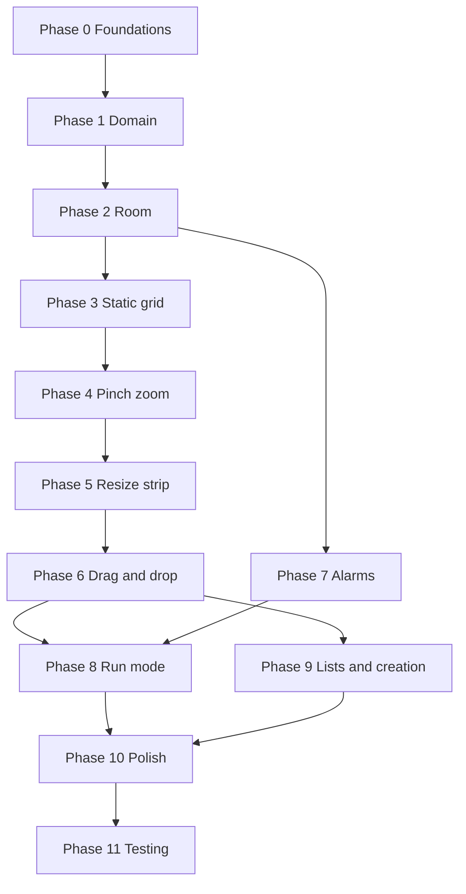

# Routine Planner — Implementation Plan

Handoff document for a new agent. Read this, then read
[`Routine Planner App Technical Specification (1).md`](../Routine%20Planner%20App%20Technical%20Specification%20(1).md)
in full. The spec is the source of truth; this plan is the execution order.

---

## Current state (already done — do not redo)

The toolchain and a buildable skeleton exist and are verified working on the
Samsung Galaxy A54 over wireless debugging.

| Item | Status |
| --- | --- |
| JDK 21 (Temurin) at `~/.local/share/jdk/jdk-21.0.13.1+2` | Done |
| Android SDK at `~/Android/Sdk` (platform-tools, android-36, build-tools 36.0.0) | Done |
| Android Studio at `~/.local/share/android-studio` | Done |
| Gradle wrapper 8.14.3 | Done |
| AGP 8.13.2, Kotlin 2.2.21, KSP 2.2.21-2.0.5, Compose BOM 2026.06.01, Hilt 2.57.2, Room 2.8.5 | Done |
| `minSdk 33`, `compileSdk 36`, `targetSdk 35`, namespace `com.adhd.routineplanner` | Done |
| Hilt `@HiltAndroidApp` [`App.kt`](../app/src/main/java/com/adhd/routineplanner/App.kt) | Done |
| Placeholder `MainActivity` + dark theme tokens (spec 15.11) | Done |
| All alarm/notification/boot permissions in [`AndroidManifest.xml`](../app/src/main/AndroidManifest.xml) | Done |
| [`deploy.sh`](../deploy.sh) with build lock, wireless reconnect, logcat | Done |
| [`pair-wireless.sh`](../pair-wireless.sh) with address validation + mDNS auto-detect | Done |
| Wireless debugging paired and app launched on device | Done |
| Phases 0–10 (foundations, domain, Room, static grid, pinch zoom, selection + resize strip, drag and drop, alarms, run mode, routine list/settings/creation, polish) | Done |
| Buffer model [`domain/Buffer.kt`](../app/src/main/java/com/adhd/routineplanner/domain/Buffer.kt) — proportional distribution of spare time across tasks | Done |
| Continuous pinch/drag resize, free-form minute durations, clock-face picker | Done |
| Unit tests: domain, repository, `ResizeGestureTest`, `PlanUiStateTest`, `RunStateTest`, `DragTest`, `ScheduleTest` | Done |

### Hard constraints — do not break these

1. **Do not bump the Compose BOM past 2026.06.01.** Compose 1.12+ requires AGP 9.1.0+.
2. **Do not bump Hilt past 2.57.2.** Hilt 2.60+ requires AGP 9.0.0+.
3. **Do not bump Kotlin without bumping KSP to the matching `<kotlin>-<ksp>` version.**
4. **`org.gradle.java.home` in [`gradle.properties`](../gradle.properties) must stay pointed at JDK 21.** The system JDK 25 is rejected by AGP 8.x.
5. **No `INTERNET` permission.** Spec §18 privacy requirement.
6. **`domain/` must have zero Android imports.** It is the unit-testable core.
7. **Never build from Android Studio and `deploy.sh` simultaneously.** `deploy.sh` takes a lock; Studio does not respect it.
8. **The human builds.** The owner of this project builds and installs from Android Studio on their own machine and verifies on the A54. Do not run `./deploy.sh`, `./gradlew`, or any Gradle task unless explicitly asked. A previous agent ran a build while Android Studio was rendering previews and crashed the laptop. Write code, then hand it over for the owner to build.

### Verification loop

```bash
./deploy.sh --build     # compile only, no device
./deploy.sh             # build + install + launch
./deploy.sh --logs      # build + install + launch + logcat
./gradlew :app:testDebugUnitTest
```

Run `./deploy.sh --build` after every task below. Do not proceed on a red build.

---

## Phase 0 — Project foundations

- [x] **0.1 Add missing dependencies to [`gradle/libs.versions.toml`](../gradle/libs.versions.toml) and [`app/build.gradle.kts`](../app/build.gradle.kts).** Needed: `androidx.compose.material.icons.extended`, `androidx.navigation.compose` (already declared), `androidx.hilt.navigation.compose` (already declared), `androidx.datastore.preferences` (already declared), `androidx.compose.ui.test.junit4`, `androidx.compose.ui.test.manifest`, `hilt-android-testing` + `hilt-android-compiler` for tests, `kotlinx-coroutines-test`, `turbine` (already declared). Add `testInstrumentationRunner = "com.adhd.routineplanner.HiltTestRunner"` and `androidTestImplementation` configs.
  - Done: added `hilt-android-testing` to the catalog, `androidTestImplementation(libs.hilt.android.testing)` + `kspAndroidTest(libs.hilt.compiler)`, switched the runner to `com.adhd.routineplanner.HiltTestRunner`, and created [`HiltTestRunner.kt`](../app/src/androidTest/java/com/adhd/routineplanner/HiltTestRunner.kt).
- [x] **0.2 Create the package skeleton** as spec §5: `data/db`, `data/model`, `domain`, `alarm`, `ui/plan`, `ui/run`, `ui/routines`, `ui/templates`, `viewmodel`. Empty packages are fine; they establish the layout.
  - Done: directories created with `.gitkeep` files so they survive version control. `ui/templates` now holds only `ColorPicker.kt`; the template editor is gone.
- [x] **0.3 Add the DSEG seven-segment font** to `app/src/main/res/font/` (spec §2, §15.8). DSEG7 Classic is SIL OFL licensed — download `DSEG7Classic-Regular.ttf`, rename to `dseg7.ttf` (lowercase, underscores only), and add a `FontFamily` in [`Type.kt`](../app/src/main/java/com/adhd/routineplanner/ui/theme/Type.kt). If the download is unavailable, fall back to `FontFamily.Monospace` with `fontFeatureSettings = "tnum"` and leave a TODO.
  - Done via the documented fallback: [`Type.kt`](../app/src/main/java/com/adhd/routineplanner/ui/theme/Type.kt) exposes `CountdownFontFamily` (Monospace), `CountdownFontFeatureSettings` (`"tnum"`) and `CountdownTextStyle`, with a `TODO(phase-8)` to swap in the real TTF.
- [x] **0.4 Add `androidx.core:core-splashscreen`** and a minimal splash theme, or explicitly decide to skip it. Low priority.
  - Decision: **skipped.** The existing `Theme.AdhdRoutineApp` already gives a dark launch background and v1 has no splash requirement. Revisit only if a cold-start flash appears on the A54.

---

## Phase 1 — Domain logic (pure Kotlin, fully unit-tested)

This is spec §12 step 1. Everything here is plain Kotlin with no Android imports.

- [x] **1.0 `domain/PlacedTask.kt` and `domain/Routine.kt`** — plain data classes mirroring the Room entities (spec §4) so `domain/` stays Android-free. The repository maps entities to these at the boundary in Phase 2.
- [x] **1.1 `domain/Schedule.kt`** — the derived-timeline core (spec §3, §14.5).
  - `fun startMinutes(tasks: List<PlacedTask>): IntArray` — prefix sums.
  - `fun totalMinutes(tasks: List<PlacedTask>): Int`
  - `fun taskAtMinute(tasks: List<PlacedTask>, minute: Int): Int?` — binary search over the prefix array.
  - `fun colorOfMinute(...)` lookup array builder.
  - `fun endMinuteOfDay(routine: Routine, tasks: List<PlacedTask>): Int` — handles crossing midnight.
  - `fun clockLabel(routineStartMinuteOfDay: Int, row: Int, cols: Int): String` — wraps at 24h.
- [x] **1.2 `domain/Reorder.kt`** — spec §7.3, §14.7.
  - `fun insertionIndex(tasks: List<PlacedTask>, minute: Int): Int` (spec gives the reference implementation).
  - `fun move(tasks: List<PlacedTask>, fromIndex: Int, toIndex: Int): List<PlacedTask>`
  - `fun resize(tasks: List<PlacedTask>, index: Int, minutes: Int): List<PlacedTask>` — clamp to `>= 1`.
  - `fun remove(tasks: List<PlacedTask>, index: Int): List<PlacedTask>`
  - `fun renumber(tasks: List<PlacedTask>): List<PlacedTask>` — reassign `position` 0..n-1.
- [x] **1.3 `domain/RunState.kt`** — spec §8.1, §8.7.
  - `data class RunState(val elapsedSeconds: Long, val currentIndex: Int, val secondsRemaining: Int, val progress: Float, val phase: Phase)` where `Phase` is `BeforeStart | Running | Finished`.
  - `fun runState(tasks: List<PlacedTask>, startMs: Long, nowMs: Long): RunState`
  - `currentIndex` is `-1` before start and `tasks.size` when finished.
- [x] **1.4 `domain/Grid.kt`** — spec §14.1, §14.3.
  - `val ZOOM_STEPS = intArrayOf(10, 8, 6, 5)`
  - `fun rowsFor(totalMinutes: Int, cols: Int): Int`
  - `fun cellAt(pos: Offset, cellPx: Float, cols: Int): Int` — spec gives the formula. Use a plain `data class Point(val x: Float, val y: Float)` instead of `Offset` to keep `domain/` Android-free.
  - `fun nextZoomStep(current: Int, accumulatedScale: Float): Int` — thresholds 1.25 / 0.8.
- [x] **1.5 `domain/DaysOfWeek.kt`** — bitmask helpers for `Routine.daysOfWeek` (Mon=1 … Sun=64). `isActiveOn(dayOfWeek)`, `toDisplayChips()`, `fromChips()`.
- [x] **1.6 Unit tests in `app/src/test/java/com/adhd/routineplanner/domain/`.** Spec §19 lists the required cases:
  - start times for 0, 1, many tasks
  - `insertionIndex` at first task, last task, exact boundary
  - move forward and backward
  - resize clamping to 1 minute
  - `runState` before start, exactly on a boundary, in the final second, after end
  - routine crossing midnight
  - DST transition (use `java.time` with a `ZoneId` parameter so it is testable)
  - `nextZoomStep` at 1.24, 1.25, 0.81, 0.80

**Gate:** `./gradlew :app:testDebugUnitTest` green before Phase 2.
**Status: PASSED** — 72 tests across 5 suites, 0 failures, 0 errors.

---

## Phase 2 — Room and repository

Spec §12 step 6, but do it before the UI so the grid has real data.

> **Superseded by the template removal.** Phase 2 was built with a third
> `TaskTemplate` entity and a `TaskTemplateDao`. Both are gone: `PlacedTask`
> now owns `name` and `color`, and the database is at **version 3** with
> `MIGRATION_2_3` rebuilding `routines` and `placed_tasks` and dropping
> `task_templates`. The entries below are kept as history; read them with that
> in mind.

- [x] **2.1 Entities** in `data/model/` — copy the entities from spec §4. Add `@TypeConverters` only if needed (the spec deliberately uses `Int` minutes to avoid one).
- [x] **2.2 DAOs** in `data/db/`:
  - `RoutineDao` — `observeAll(): Flow<List<Routine>>`, `observeById(id): Flow<Routine?>`, `getById(id)`, `upsert`, `delete`, `setEnabled`.
  - ~~`TaskTemplateDao`~~ — **deleted**.
  - `PlacedTaskDao` — `observeForRoutine(routineId): Flow<List<PlacedTask>>` ordered by `position`, `getForRoutine(routineId)`, `replaceAll(routineId, tasks)` in a `@Transaction`, `deleteForRoutine`.
- [x] **2.3 `AppDatabase`** — `@Database(entities = [...], version = 3, exportSchema = true)`. Room writes schemas to `app/schemas` via the KSP arg in [`app/build.gradle.kts`](../app/build.gradle.kts); `3.json` is generated on the next build.
- [x] **2.4 `data/RoutineRepository.kt`** — `@Singleton`, injected DAOs. Methods: `observeRoutines()`, `observeRoutine(id)`, `observeTasks(routineId)`, `saveRoutine`, `deleteRoutine`, `commitTasks(routineId, tasks)` (single transaction + renumber + `alarmScheduler.rescheduleRoutine`), `insertRoutineWithTasks(routine, tasks)`, `isRoutineTableEmpty()`. The template CRUD methods are gone.
- [x] **2.5 Hilt module** `di/DatabaseModule.kt` — provides `AppDatabase`, the two DAOs, and `DataStore<Preferences>`.
- [x] **2.6 Seed data on first run** — one sample routine with 3–4 tasks carrying inline names and the first stock colours, guarded by `isRoutineTableEmpty()`. There is no `Free time` template; the buffer fills the gaps.
- [x] **2.7 Repository tests** — Room in-memory database, verify `commitTasks` renumbers `position`, that cascade delete removes placed tasks, and that `insertRoutineWithTasks` keeps the order the creation sheet arranged.

**Gate:** build green, repository tests green.

---

## Phase 3 — Static grid rendering

Spec §12 step 2, §14.2, §14.4.

- [x] **3.1 `ui/plan/GridCanvas.kt`** — one `Canvas` composable taking `tasks`, `cols`, `cellPx`, `routineStartMinuteOfDay`, `selectedId`, `endByMinute`, `preview`. Implement the nine-layer draw order from spec §14.2 exactly:
  1. background
  2. empty-cell fill with 0.5dp borders
  3. task cell fills
  4. task outlines and names
  5. guide lines every 5 minutes
  6. overflow tint past `endByMinute`
  7. selection outline
  8. drag preview and insertion marker
  9. (run mode only — leave a parameter hook)
- [x] **3.2 Block segment rendering** per spec §14.4: one rounded rect per row segment, rounded corners only at the true start and end, name clipped and ellipsised in the first segment (skip to the next row if the first segment is a single cell), no label for 1–2 minute tasks, label colour chosen by luminance.
- [x] **3.3 Left gutter** — 44dp column, row clock labels from `clockLabel()`.
- [x] **3.4 Empty tail rows** — at least one faint row after the last task so a drop at the end is possible (spec §14.1).
- [x] **3.5 `ui/plan/PlanScreen.kt`** — top bar, grid, tray placeholder. Wire it to a hardcoded `List<PlacedTask>` first, then to the repository Flow.
- [x] **3.6 Scrolling** — Canvas inside a vertical scroll container sized `rows * cellPx`, drawing only visible rows (spec §14.6).
- [x] **3.7 Navigation** — `ui/AppNavHost.kt` with `RoutineList → Plan(routineId) → Run(routineId)` (spec §15.1). Replace the placeholder in [`MainActivity.kt`](../app/src/main/java/com/adhd/routineplanner/MainActivity.kt).

**Gate:** deploy to the A54 and confirm the grid draws correctly at 10 columns with real data.

---

## Phase 4 — Pinch zoom

Spec §12 step 3, §14.3.

- [x] **4.1 `detectTransformGestures`** accumulating scale; step at 1.25 / 0.8; reset the accumulator; fire a haptic tick per step.
- [x] **4.2 Keep the focal minute stationary** by adjusting scroll offset after each step.
- [x] **4.3 Animate cell size** with `animateDpAsState` over ~200ms.
- [x] **4.4 Zoom -/+ buttons** in the overflow menu (spec §18 accessibility requirement — every gesture needs a button equivalent).
- [x] **4.5 Verify** `cols` is the only thing that changes; the task list is untouched.

---

## Phase 5 — Selection and resize strip

Spec §12 step 4, §15.4.

- [x] **5.1 Tap-to-select** — hit-test via `cellAt` + `taskAtMinute`, set `selectedId`, draw the selection outline.
- [x] **5.2 `ui/plan/ResizeStrip.kt`** — 72dp wide, opens on the right, grid reflows with a 150ms animation. Contents top to bottom: close + delete buttons, task name, large minute count with -1/+1, vertical ruler, coloured bar from top to the 48dp drag handle.
- [x] **5.3 Continuous resize** — see 5.7 and 5.8. The original "`dy / 12dp` → whole minutes" design was replaced: it gave one step per gesture and free-form minute counts.
- [x] **5.4 Strip scrolling** for long tasks, auto-scrolling when the handle is within 64dp of the bottom.
- [x] **5.5 `PlanViewModel`** — implement `PlanUiState` and `PlanEvent` from spec §16. `ResizePreview` updates `preview` only; `ResizeCommit` runs the commit pipeline.
- [x] **5.6 Commit pipeline** — snapshot for undo, one Room transaction with renumbering, then `AlarmScheduler.rescheduleRoutine(id)`. Previews never touch Room or alarms (spec §6, §16).
- [x] **5.7 Duration ladder** — `domain/Durations.kt`, pure Kotlin, no Android imports. `LADDER = intArrayOf(5, 10, 15, 20, 25, 30, 45, 60, 90, 120)` with `snap` (nearest, ties to larger), `next`, `previous`, `indexOf`, `shift`, `MIN`, `MAX`. Covered by 15 tests in [`DurationsTest.kt`](../app/src/test/java/com/adhd/routineplanner/domain/DurationsTest.kt).
  **Superseded:** the ladder is no longer applied to task durations. The clock-face picker accepts any minute value from 1 up, clamped to `Buffer.maxDurationFor`. `Durations.kt` and its tests remain in the tree but are no longer on the task-duration path.
- [x] **5.8 Continuous, reversible resize** — two input methods, both sensitivity-driven rather than one-step-per-gesture:
  - **Two-finger pinch on the strip** (`detectTransformGestures`). Logarithmic mapping `steps = ln(accumulatedScale) / ln(1.25)`, so a 25% change in finger separation is one minute and pinching in and back out returns to the starting duration. Accumulated scale and starting duration are captured on gesture start.
  - **Handle drag** via [`ResizeGesture.kt`](../app/src/main/java/com/adhd/routineplanner/ui/plan/ResizeGesture.kt) — accumulates total finger travel from the gesture origin rather than per-event deltas, so reversing direction mid-gesture walks back immediately. 44dp per minute. Covered by 14 tests in [`ResizeGestureTest.kt`](../app/src/test/java/com/adhd/routineplanner/ui/plan/ResizeGestureTest.kt).
  - Both fire a haptic tick per minute change and commit only on release. Releasing at the same duration is a no-op (no undo snackbar).
- [x] **5.9 Ruler** — one tick per minute at 44dp apart, labelled every 5 minutes via Compose `TextMeasurer` + `drawText` (consistent with [`GridCanvas.kt`](../app/src/main/java/com/adhd/routineplanner/ui/plan/GridCanvas.kt)). The `-`/`+` buttons step one minute.
- [x] **5.10 `PlanUiStateTest`** — pure-JVM tests for `displayTasks`, `totalMinutes`, `capacityMinutes`, `bufferMinutes`, `maxDurationFor`, `selectedTask` and `PlanPreview.isEmpty`.

---

## Phase 6 — Drag and drop

Spec §12 step 5, §15.5, §17 gesture state machine.

- [x] **6.1 `GridGesture` state machine** — `Idle | Scrolling | Zooming | DraggingTask | Resizing` exactly as spec §17. Scrolling is the default; drags start only after `detectDragGesturesAfterLongPress` (~350ms); consume pointers only after the long-press fires.
- [x] **6.2 Move a placed task** — remove from the list, show a live preview with later tasks sliding forward (150ms), reinsert at drop. Faint dashed placeholder at the origin.
- [x] **6.3 `ui/plan/DragOverlay.kt`** — ghost with name and minutes, scale 1.05, elevated, offset ~40dp above the finger.
- [x] **6.4 Insertion marker** at the hovered boundary; recompute layout with the task inserted.
- [x] **6.5 Auto-scroll** within 72dp of the grid's top or bottom edge.
- [x] **6.6 Tray** — `ui/plan/TaskTray.kt` is now a single **+ Add task** button that opens `TaskCreateDialog`. The chip row and drag-in placement were removed with the templates.
- [x] **6.7 Delete** — dragging over the tray turns it red; drop deletes. Also a delete button in the strip, wired through `PlanScreen` to `PlanViewModel.deleteTask`.
- [x] **6.8 Cancel paths** — second finger, back gesture, system cancel all cancel with no change.
- [x] **6.9 Haptics** — tick per cell crossed, long-press on lift, confirm on drop. (Long-press on lift and zoom ticks are wired; per-cell tick and drop confirm are deferred to Phase 10 polish.)
- [x] **6.10 Undo** — snackbar after every committed edit, restoring the snapshot and rescheduling. The snackbar and `UndoSnapshot` plumbing already exist from Phase 5; reuse it rather than adding a second mechanism.

**Note on durations:** superseded. A task's duration is a free-form minimum chosen on the clock face and clamped to `Buffer.maxDurationFor(capacity, otherTasksMinimums)`. Nothing snaps to the ladder any more.

**Gate:** deploy and exercise every row of the spec §14.7 capability table on the device.

---

## Phase 7 — Alarms and permissions (do this before run mode)

Spec §12 step 7, §9, §15.9, §15.10, §20. Spec §20 explicitly says to build the
checklist and Test alarm button here so alarm reliability is proven on the A54
before run mode is layered on top.

- [x] **7.1 `alarm/AlarmScheduler.kt`** — `schedule(routine, tasks)`, `cancel(routineId)`, `rescheduleRoutine(routineId)`, `rescheduleAll()`.
  - Use `setAlarmClock()` (spec §17: treated as a real alarm, exempt from Doze) with a fallback to `setExactAndAllowWhileIdle`.
  - `PendingIntent` request code derived from the task id.
  - Schedule only the next occurrence per task.
  - Respect the per-routine granularity setting (every task start vs routine start only).
  - Done: `AlarmManagerScheduler` depends on `RoutineDao`/`PlacedTaskDao` directly (avoids a repository↔scheduler cycle). `setAlarmClock` with `AlarmClockInfo` show-intent, falling back to `setExactAndAllowWhileIdle` then `setAndAllowWhileIdle` on `SecurityException`. Request code is `requestCodeFor(routineId, taskIndex)`; `cancel()` sweeps `-1 until MAX_TASKS_PER_ROUTINE`. Date math lives in the Android-free [`domain/AlarmSchedule.kt`](../app/src/main/java/com/adhd/routineplanner/domain/AlarmSchedule.kt) and is unit-tested.
- [x] **7.2 `alarm/AlarmReceiver.kt`** — post a high-priority `CATEGORY_ALARM` notification with a full-screen intent, `USAGE_ALARM` audio, then schedule the next alarm.
  - Done: `@AndroidEntryPoint` receiver using `goAsync()`; resolves the task name before posting, attaches the full-screen `PendingIntent` only when `canUseFullScreenIntent()`, then calls `rescheduleRoutine`.
- [x] **7.3 `alarm/BootReceiver.kt`** — `BOOT_COMPLETED`, `TIME_SET`, `TIMEZONE_CHANGED` → `rescheduleAll()`.
  - Done: also handles `MY_PACKAGE_REPLACED`; registered `exported=true` in the manifest.
- [x] **7.4 `alarm/AlarmActivity.kt`** — `setShowWhenLocked`, `setTurnScreenOn`, routine name and `Next: task (N min)`, Dismiss button, ~5s tone, tap opens Run. Register it in [`AndroidManifest.xml`](../app/src/main/AndroidManifest.xml) with the full-screen intent filter.
  - Done: Compose alarm screen, `FLAG_KEEP_SCREEN_ON`, keyguard dismiss request, `MediaPlayer` on `USAGE_ALARM` stopped after 5s, tap launches `MainActivity` with `ACTION_OPEN_RUN`.
- [x] **7.5 Permission checks** — `canScheduleExactAlarms()`, `canUseFullScreenIntent()`, `POST_NOTIFICATIONS`, battery optimisation status. Deep links: `ACTION_REQUEST_SCHEDULE_EXACT_ALARM`, `ACTION_MANAGE_APP_USE_FULL_SCREEN_INTENT`, `ACTION_REQUEST_IGNORE_BATTERY_OPTIMIZATIONS`.
  - Done: [`alarm/AlarmPermissions.kt`](../app/src/main/java/com/adhd/routineplanner/alarm/AlarmPermissions.kt) with `AlarmPermissionStatus` and version-gated checks plus deep-link intent builders.
- [x] **7.6 `ui/routines/PermissionChecklist.kt`** — one row per requirement with a status tick and a deep-link button, re-checked on resume, plus a **Test alarm in 1 minute** button (spec §15.10).
  - Done: `PermissionChecklistViewModel` + screen; `LifecycleEventEffect(ON_RESUME)` refresh, `RequestPermission` launcher for `POST_NOTIFICATIONS`, and a test alarm scheduled via `AlarmScheduler.scheduleTestAlarm(1)`.
- [x] **7.7 Notification channel** setup in `App.kt` or a Hilt-injected initialiser.
  - Done: [`alarm/NotificationChannels.kt`](../app/src/main/java/com/adhd/routineplanner/alarm/NotificationChannels.kt), created idempotently from `App.onCreate` and from the checklist view model.
- [ ] **7.8 Device verification on the A54** — spec §19 device tests (owner runs these; not automatable):
  - test alarm 1 minute ahead, screen off
  - 30-minute routine, screen off, unplugged
  - reboot → alarms rescheduled
  - `adb shell dumpsys deviceidle force-idle`
  - change time zone and system time
  - DND on, battery saver on
  - app swiped from recents

**Gate:** every alarm fires within a few seconds of its scheduled time. Do not start Phase 8 until this passes.

---

## Phase 8 — Run mode

Spec §12 step 8, §8, §15.8.

- [ ] **8.1 Run session persistence** — `(routineId, startMs)` in DataStore (spec §16). Manual Run uses `System.currentTimeMillis()`; scheduled runs use today's occurrence of the routine start.
- [ ] **8.2 Clock flow** — `produceState` recomputing from the wall clock every second, never counting ticks (spec §8.1 gives the exact snippet).
- [ ] **8.3 `RunViewModel`** — combine the session, task list and clock flow, derive everything through `runState()`.
- [ ] **8.4 `ui/run/RunGrid.kt`** — past minutes full colour, future minutes `lerp(color, background, 0.7f)`, current minute washed with the left fraction filled bright to the cursor, thin borders.
- [ ] **8.5 Cursor** — fractional minutes, `animateFloatAsState(tween(1000, LinearEasing))`, wraps to the next row.
- [ ] **8.6 `ui/run/WaterBox.kt`** — 110dp tall, 16dp corners, washed background, bright water rising by `progress`, sine wave on the surface with an infinite ~3s phase animation, name in white with a shadow. Read the clock inside the draw scope so only the Canvas redraws (spec §18).
- [ ] **8.7 `ui/run/Countdown.kt`** — red `-M:SS` in DSEG or tabular numerals.
- [ ] **8.8 Auto-scroll** keeping the cursor row vertically centred; `keepScreenOn`.
- [ ] **8.9 States** — before start (`Starts in -M:SS`, all washed), running, finished (`Done`, all full colour).
- [ ] **8.10 Task boundary transition** — water drains and refills over ~300ms, name crossfades, haptic.
- [ ] **8.11 Exit** — X button and back open a confirm dialog; confirming stops the run and cancels remaining alarms.
- [ ] **8.12 Disable editing** while a run is active.

---

## Phase 9 — Routine list, settings, creation

Spec §15.2, §15.6, §15.7.

> **Templates were removed.** There is no task library. A task owns its own
> `name` and `color` ([`domain/PlacedTask.kt`](../app/src/main/java/com/adhd/routineplanner/domain/PlacedTask.kt)),
> and the user types a name and picks a colour whenever they add one. The old
> `TaskTemplateEntity`, `TaskTemplateDao`, `TemplateEditorViewModel` and
> `ui/templates/TemplateEditor.kt` are gone; `MIGRATION_2_3` drops the
> `task_templates` table. `ui/templates/ColorPicker.kt` survives only as a
> reusable swatch/slider widget.

- [x] **9.1 `ui/routines/RoutineListScreen.kt`** — Done: LazyColumn of cards with name, start time, day chips, total duration, end time, enable switch, Run button. Tap opens Plan. Swipe to delete with undo snackbar, plus an explicit Delete item in the card overflow menu. FAB opens the creation sheet. Overflow menu reaches the permission checklist.
- [x] **9.2 `ui/routines/RoutineSettings.kt`** — Done: bottom sheet with name, **start and end time pickers** (the routine is a fixed window), a live `N min window` line, 7 day toggles and an enabled switch. The old routine-level alarm mode is gone — alarms are per task.
- [x] **9.3 `ui/routines/RoutineCreateSheet.kt`** — Done: `ModalBottomSheet` that creates a routine and its tasks in one go. Name field, start/end time pickers with a live `capacity · claimed · spare` summary, day chips, and a staged task list that can be reordered by long-press drag, tapped to edit, or removed. Each task is added through `DraftTaskDialog` (name, colour swatches, −5/−1/+1/+5 duration buttons). Saving maps `DraftTask` → `PlacedTask` and calls `RoutineListViewModel.createRoutineWithTasks`, which delegates to `RoutineRepository.insertRoutineWithTasks` (that method renumbers positions from list order, so the sheet must not pre-position).
- [x] **9.4 `ui/templates/ColorPicker.kt`** — Done: swatch row plus hue and brightness sliders. No longer reachable from a template editor; kept for reuse.
- [x] **9.5 `RoutineListViewModel`** — Done: observes routines, toggles enabled (which reschedules alarms), deletes with undo, and creates routines either blank (`createRoutine`) or with staged tasks (`createRoutineWithTasks`).
- [x] **9.6 Buffer model** — Done: see the note below. The routine window is a hard boundary; spare minutes are distributed across the tasks rather than left as empty grid cells.

---

## Phase 10 — Polish and accessibility

Spec §12 step 9, §18.

- [x] **10.1 Accessibility** — content descriptions on blocks reading name, start time and length; button equivalents for every gesture (resize +/-, zoom -/+, move earlier/later in the selection actions); respect system font scale.
  Done: new [`domain/TaskDescription.kt`](../app/src/main/java/com/adhd/routineplanner/domain/TaskDescription.kt) builds the spoken wording ("Wash, starts 7:05, 10 minutes"). The plan grid and run grid each expose one `contentDescription` summarising the whole Canvas, since the blocks are drawn with no layout nodes of their own. The selection dialog gained an "Adjust" section with −1 min / +1 min and Earlier / Later buttons, backed by new `PlanViewModel.stepTaskDuration` and `PlanViewModel.moveTask`. Zoom already had menu items. All text uses `sp`, so system font scale applies automatically.
- [x] **10.2 Performance** — draw only visible rows, precompute lookup arrays, reuse `Path` objects, keep the wave animation confined to the header Canvas.
  Done: verified only. [`GridCanvas.kt`](../app/src/main/java/com/adhd/routineplanner/ui/plan/GridCanvas.kt) already derives `firstRow`/`lastRow` from the visible pixel range and skips every row outside it; `placed`, `totalMinutes`, `starts` and `contentRows` are all `remember`ed; `segmentPath` and `drawDashedRect` reuse `Path` objects. [`WaterBox.kt`](../app/src/main/java/com/adhd/routineplanner/ui/run/WaterBox.kt) reads the wave phase inside its own draw scope, so only the header Canvas invalidates.
- [x] **10.3 `systemGestureExclusionRects`** or ~24dp horizontal grid padding so Samsung edge-swipe back does not fight the grid (spec §17).
  Done: took the padding option. `GridEdgePadding = 24.dp` on the plan grid and the same 24dp on the run grid, so neither Canvas reaches the screen edge.
- [x] **10.4 Haptics audit** — tick per cell crossed, per zoom step, long-press on lift, confirm on drop.
  Done: the plan grid now tracks `lastDragMinute` and fires one `TextHandleMove` tick per cell crossed rather than per pointer event; lift and drop both fire `LongPress`. Pinch zoom already ticked per step, and the tray chip already ticked on long-press.
- [x] **10.5 Animation audit** — 150–200ms everywhere except the 1000ms linear cursor.
  Done: `BOUNDARY_MS` in [`RunScreen.kt`](../app/src/main/java/com/adhd/routineplanner/ui/run/RunScreen.kt) was 300ms and is now 200ms. `ZOOM_ANIMATION_MS` is 200ms, the run cursor is 1000ms linear, and the water wave is a 3000ms repeating loop that the spec exempts.
- [x] **10.6 Empty states** — no routines, no tasks in a routine.
  Done: "No routines yet" in [`RoutineListScreen.kt`](../app/src/main/java/com/adhd/routineplanner/ui/routines/RoutineListScreen.kt), and "No tasks yet" with a hint to use the + button, shown over the plan grid whenever the routine is empty and no run is active. The "No templates yet" state went away with the templates.
- [ ] **10.7 Release build** — verify `assembleRelease` with minify and the existing [`proguard-rules.pro`](../app/proguard-rules.pro) keeps Room/Hilt working.

---

## Phase 11 — Testing and acceptance

Spec §19.

- [ ] **11.1 Compose UI tests** — pinch steps columns and keeps the focal minute stable; a swipe scrolls while a long-press drags; a second finger cancels a drag; resize updates later tasks.
- [ ] **11.2 Full device test pass** on the A54 covering every item in the Phase 7.8 list plus run mode.
- [ ] **11.3 v1 acceptance** — in all of the above, each alarm fires within a few seconds of its scheduled time.

---

## Dependency graph



Phase 7 can run in parallel with Phases 3–6 once Phase 2 is done, because it only
depends on the repository. Phase 8 needs both 6 and 7.

Phases 4 and 5 are complete, including continuous pinch/drag resizing. Durations
are free-form minimums now: anything that accepts one must clamp it through
`Buffer.maxDurationFor(capacity, otherTasksMinimums)`, and anything that draws or
times the timeline must read the rendered lengths from `Buffer.layout`.

---

## The buffer model — read this before touching the timeline

A routine is a **fixed window**: `startMinuteOfDay` → `endMinuteOfDay`
([`domain/Routine.kt`](../app/src/main/java/com/adhd/routineplanner/domain/Routine.kt)).
`capacityMinutes` is the window length, with day-wrap handled (a zero-length
window is treated as a full day).

Each task stores a **minimum** duration. The routine therefore has:

- `claimed = sum(task.minutes)`
- `buffer = capacity - claimed`

There is **no empty space on the grid**. The buffer is distributed across the
tasks **proportionally to each task's minimum**, using the largest-remainder
method so the rendered lengths always sum to exactly `capacity`. A 1-minute task
in a 60-minute routine does not balloon; a 30-minute task absorbs most of the
spare time. This is [`domain/Buffer.kt`](../app/src/main/java/com/adhd/routineplanner/domain/Buffer.kt):

```kotlin
Buffer.layout(tasks, capacity)   // -> Layout(slots, capacity, claimed, buffer, overrun)
Buffer.distribute(buffer, weights)
Buffer.maxDurationFor(capacity, otherTasksMinimums)
```

**Rendered vs minimum durations.** Everything that draws, hit-tests, times or
speaks the timeline uses the *rendered* (buffer-inclusive) durations:

| Consumer | Uses |
| --- | --- |
| [`Schedule.startMinutes(routine, tasks)`](../app/src/main/java/com/adhd/routineplanner/domain/Schedule.kt) | rendered prefix sums |
| [`Schedule.renderedMinutes(routine, tasks)`](../app/src/main/java/com/adhd/routineplanner/domain/Schedule.kt) | rendered lengths |
| [`RunState`](../app/src/main/java/com/adhd/routineplanner/domain/RunState.kt) | rendered lengths for the countdown |
| [`Drag.boundariesOf(routine, tasks)`](../app/src/main/java/com/adhd/routineplanner/domain/Drag.kt) | rendered boundaries |
| `GridCanvas(capacityMinutes = …)` | rendered layout |
| `RunGrid(totalMinutes, renderedMinutes)` | rendered layout |
| `RunUiState.renderedMinutes` / `currentTaskMinutes` | rendered lengths |

Only the duration picker's capacity maths uses minimums:
`Schedule.minimumStartMinutes`, `Schedule.totalMinutes` and
`Buffer.maxDurationFor`. `TaskEditDialog` and `TaskCreateDialog` take a
`maxMinutes` and clamp the chosen duration to it, showing
"Up to N min available" / "Routine is full at N min".

`PlanViewModel.setTaskDuration` deliberately clamps only to ≥1: the duration is a
minimum, and the buffer is redistributed on top of it. The UI is responsible for
warning when the total exceeds the window.

**Per-task alarms.** `PlacedTask.alarmEnabled` is the only alarm switch. The
routine-level `alarmMode` was removed; `AlarmScheduler` schedules exactly the
tasks with `alarmEnabled = true`, at their rendered start minutes.

---

## Notes for the implementing agent

- **Read the spec section before writing each file.** The spec is unusually precise — draw order, dp values, thresholds and animation durations are all specified. Do not invent alternatives.
- **`domain/` stays Android-free.** If you need `Offset` or `Color` there, define a plain data class instead.
- **Commit to Room only on release**, never during a drag or resize (spec §6).
- **Durations are minimums, not fixed lengths.** The user picks a minimum; the buffer is distributed on top. Never assume `task.minutes` is what the grid draws — use `Schedule.renderedMinutes` or `Buffer.layout`. The old `Durations.snap()` ladder is no longer applied to task durations; the clock-face picker accepts any minute value.
- **Gestures are continuous, not stepped.** The resize strip accumulates total finger travel (or accumulated pinch scale) from the gesture origin and maps it to a minute, so reversing direction mid-gesture reverses the value immediately. Do not reintroduce per-event delta accumulation — it makes the control feel like one step per swipe.
- **Test on the device, not just the emulator.** Samsung's battery management and gesture navigation are the two things most likely to break this app, and neither reproduces on an emulator.
- **Deploy after every phase.** `./deploy.sh` — the loop is fast and catches device-only problems early.
- **If a dependency upgrade is tempting, re-read the hard constraints above first.** The version set is deliberately pinned to the newest AGP 8.x-compatible combination.
