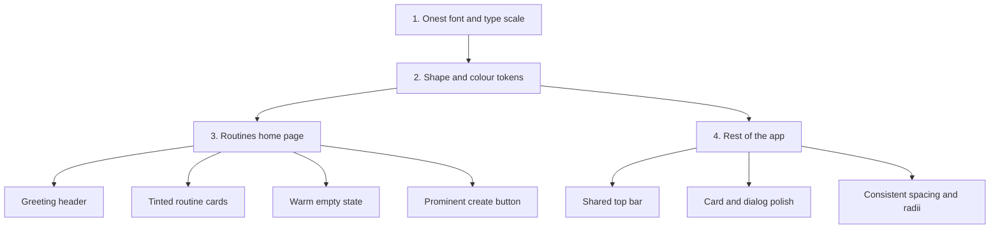

# Visual Refresh — "Homely, Warm & Dark"

> **Status:** Plan / approved direction. Font chosen: **Onest** (single family).
> Goal: make the app feel homely, warm and clean — through **typography, physical
> structure/shape, and warm dark colour** — starting with the routines home page
> and then applied consistently across the rest of the app.

---

## 1. Direction (agreed)

- **One font: Onest.** A single geometric-humanist sans, used at several weights.
  It carries both headings and body, so the app reads as one coherent voice.
  Licensed under the SIL Open Font License, so it can be bundled in the APK.
- **Warm and dark.** Keep the existing warm-charcoal base (`#14110F` background,
  `#1E1A17` surface, amber accent). Do **not** introduce a light theme or dynamic
  colour — the app is dark-only by design (spec §10).
- **Structure and shape matter as much as colour.** Generous padding, larger
  corner radii, soft elevation/tints so cards feel like objects on a surface,
  clear hierarchy (big title → supporting line → content), and grouped sections
  with breathing room.
- **The run screen is the reference.** [`RunNowNextCard`](../app/src/main/java/com/adhd/routineplanner/ui/run/RunNowNextCard.kt:67)
  already uses 28dp corners, a colour wash and big type. The rest of the app
  should catch up to that standard, not the other way round.

---

## 2. What's wrong today (grounded in the code)

- **Typography is untouched.** [`Type.kt`](../app/src/main/java/com/adhd/routineplanner/ui/theme/Type.kt:37)
  only overrides `headlineMedium` and `bodyMedium`; everything else is Roboto at
  Material defaults. There is no `res/font/` directory and no font dependency.
  This is the single biggest reason the app feels generic.
- **The routines home page is flat.** [`RoutineCard`](../app/src/main/java/com/adhd/routineplanner/ui/routines/RoutineListScreen.kt:387)
  is a plain `Surface` rectangle with 12dp corners: a name, a switch, weekday
  letters and three grey stats. No colour, no icon, no personality. The empty
  state is a bare `Text("No routines yet")` ([line 218](../app/src/main/java/com/adhd/routineplanner/ui/routines/RoutineListScreen.kt:218)).
- **No per-routine colour.** [`Routine`](../app/src/main/java/com/adhd/routineplanner/domain/Routine.kt:19)
  has no colour field; colour lives only on tasks. Cards can't be tinted without
  either a schema change or a deterministic tint derived from the routine id.
- **Shapes are uniform and small.** Everything is 8–12dp corners, no elevation,
  no surface tints. Functional but cold.

---

## 3. Plan

### Step 1 — Onest font + full type scale
- Add `app/src/main/res/font/` with Onest TTFs (Regular, Medium, SemiBold, Bold).
  Onest is OFL-licensed; download from Google Fonts and drop the static weights in.
- Define `OnestFontFamily` in [`Type.kt`](../app/src/main/java/com/adhd/routineplanner/ui/theme/Type.kt:37)
  using `Font(R.font.onest_regular, FontWeight.Normal)` etc.
- Replace the two-style override with a **complete** `Typography` scale
  (displayLarge → labelSmall), all in Onest, with tuned sizes/line-heights/weights
  for a warm, readable feel. Keep the countdown's tabular-numeral treatment.

### Step 2 — Shape and colour tokens
- Add a `Shapes` object (small 12dp, medium 20dp, large 28dp) and wire it into
  [`Theme.kt`](../app/src/main/java/com/adhd/routineplanner/ui/theme/Theme.kt:33).
- Extend [`Color.kt`](../app/src/main/java/com/adhd/routineplanner/ui/theme/Color.kt:11)
  with `SurfaceElevated`, `SurfaceSunken`, `AccentSoft` (a low-alpha amber wash),
  and a `RoutineTints` list reusing the earthy palette.
- Add a small helper to derive a stable tint from a routine id
  (`RoutineTints[(id % size).toInt()]`) so cards are colourful without a schema
  change.

### Step 3 — Routines home page (the main ask)
- **Greeting header**: replace the plain "Routines" title with a warm greeting
  ("Good morning") plus today's date, in Onest.
- **Tinted cards**: each card gets a soft colour wash or left accent bar from its
  routine tint, plus a coloured icon chip. Larger radius (20dp), gentle elevation.
- **Tidier stats**: restyle the Start / End / Length row as pill-style chips or a
  cleaner aligned row with the new type.
- **Warm empty state**: an icon, a friendly line, and a big "Create your first
  routine" button instead of bare text.
- **Prominent create affordance**: a clear pill/FAB rather than a small `+`.

### Step 4 — Rest of the app (consistency)
- **Shared `AppTopBar`** composable so every screen's bar matches (title style,
  background, spacing).
- Apply the new radii, surface tints and type to the plan screen, settings, the
  create flow, and all dialogs.
- Align the run screen to the new tokens/type (keep its layout).

---

## 4. Guardrails

- **No light theme, no dynamic colour** — dark-only by design.
- **No heavy gradients or neon** — "homely" means warm, soft, colourful accents.
- **Don't break the run state machine** — the run screen's behaviour is untouched;
  only its tokens/type change.
- **No schema change required** — routine tints are derived from the id.
- **Verify by code review** — the user has asked that builds not be run (they
  crash the machine), so changes are reviewed manually.
